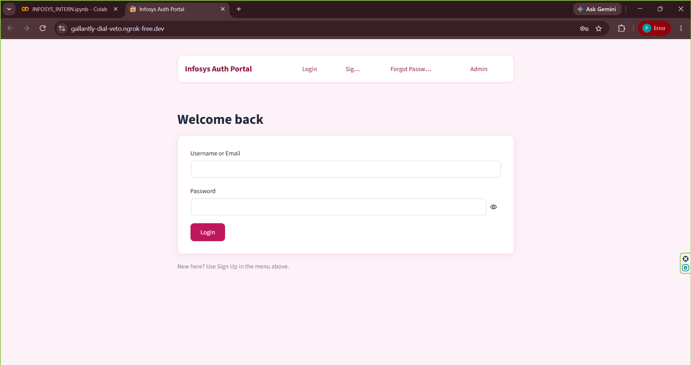
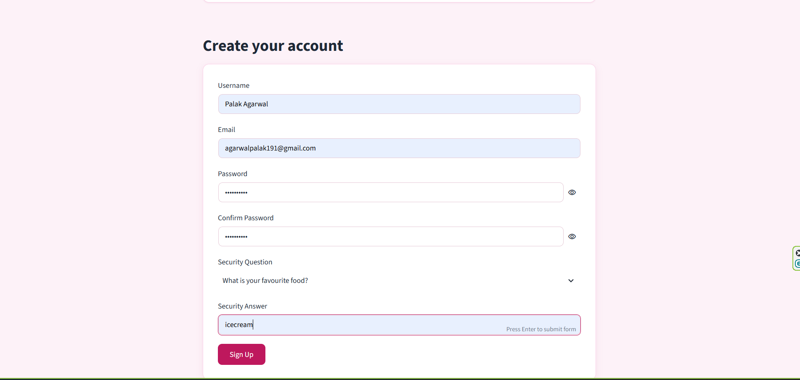
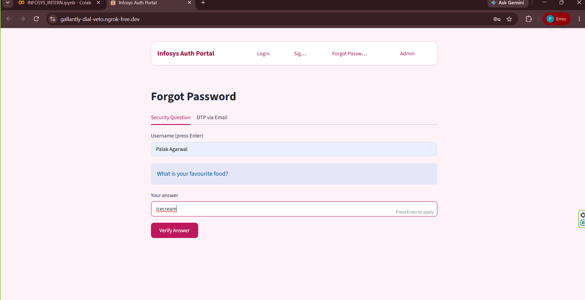
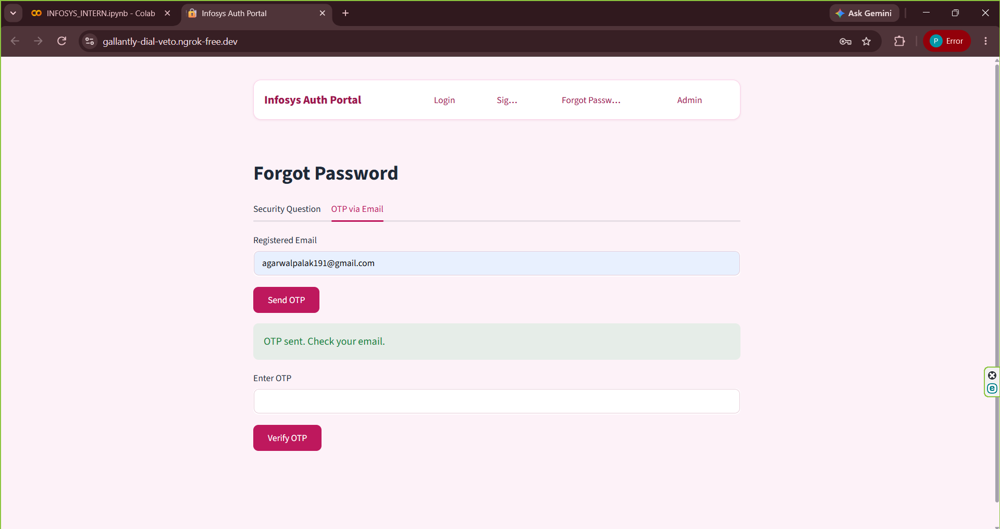
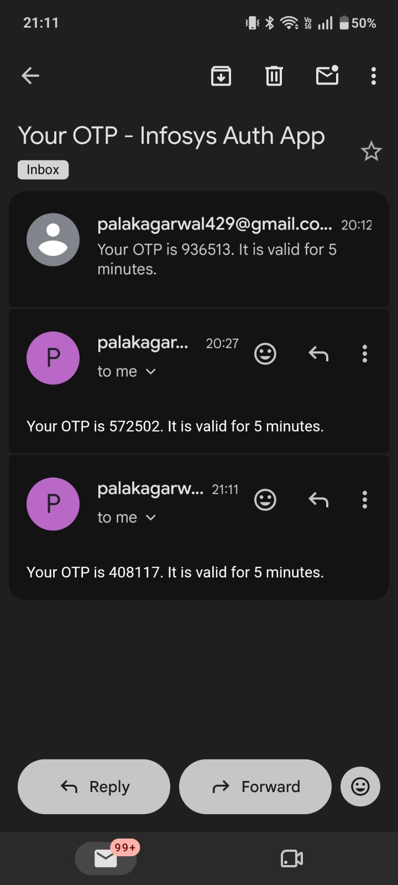
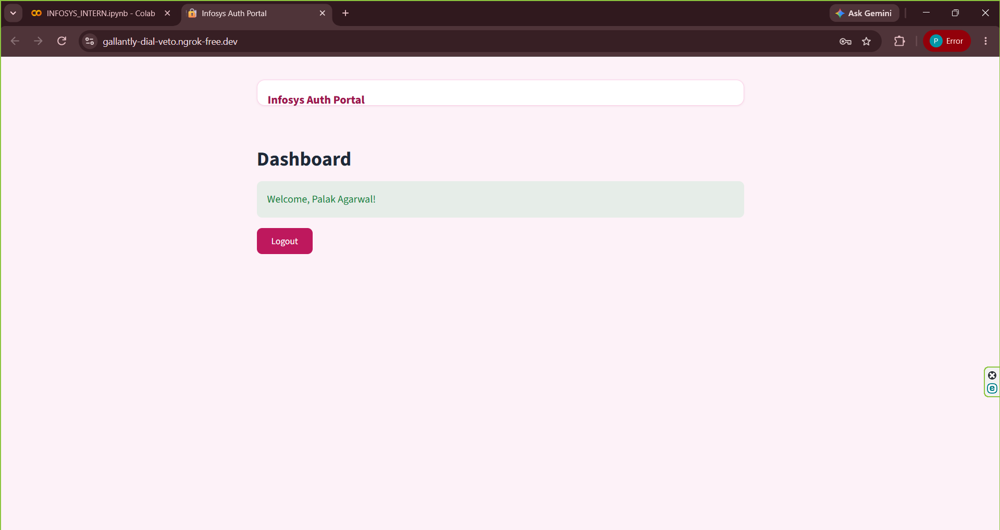
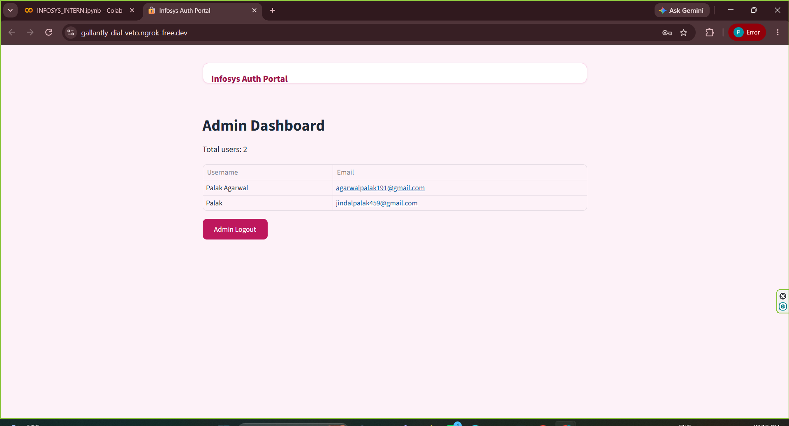

# Milestone 1 - User Authentication Module

Infosys Springboard 7.0, Batch 4.

## About
A user authentication system built in Google Colab and shared through an ngrok public link.

## Features
- Signup, Login, and Forgot Password (security question and OTP email)
- JWT session handling
- Field validation (email and password rules)
- User Dashboard and Admin Dashboard

## Tech Stack
Python, Streamlit, JWT, ngrok, Gmail SMTP

## How to Run
1. Open the notebook in Google Colab.
2. Add the secrets in Colab Secrets.
3. Run all cells and open the ngrok link.

## Screenshots

